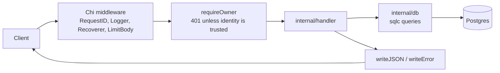

# Architecture

`template-go` is one Go binary. It serves JSON over HTTP with Chi, stores notes in Postgres through pgx and sqlc, and reads all configuration from environment variables in one package. The notes slice is an example: replace it with your own domain and keep the structure.

## Request flow

## Code map

| Path | Responsibility | Reuse, don't recreate |
| --- | --- | --- |
| `cmd/server/main.go` | Load config, open the pool, apply the schema, build the router, shut down gracefully. | Add routes in `SetupRouter`; mount feature routes with `Routes()`. |
| `internal/config/config.go` | The only place that reads environment variables. | Add a field and a `getEnv` call here; never call `os.Getenv` elsewhere. |
| `internal/handler/respond.go` | JSON responses and the error envelope. | `writeJSON`, `writeError`, `decodeJSON`. |
| `internal/handler/middleware.go` | Request body cap. | `LimitBody`. |
| `internal/handler/notes.go` | Notes example: identity check, validation, CRUD handlers. | `requireOwner`, `ownerFrom`, `cleanTitle`, `cleanBody`. |
| `internal/handler/health.go`, `root.go` | Health and greeting endpoints. | Build new simple endpoints on `writeJSON`. |
| `internal/db` | Generated by sqlc. Do not edit. | Change `sql/` and run `make generate`. |
| `sql/schema.sql`, `sql/queries.sql` | Schema and named queries. | `sql.Schema` (embedded in `sql/embed.go`) is what the server applies at start. |
| `scripts/repo-policy.mjs` | Shared policy checker. Do not edit. | Configure through `scripts/repo-policy.json`. |

> [!NOTE]
> The notes slice is the example feature. TEMPLATE-TODO markers in the code show what to replace when you derive a service.

## Invariants

- Every query on `notes` filters by `owner_id`. [review-only]
- Only `internal/config` reads environment variables. [enforced by ast-grep]
- Every endpoint answers errors with `{"error":{"message":"..."}}` and `Content-Type: application/json`. [review-only]
- No empty function stubs. [enforced by ast-grep]
- Ignored errors, unclosed bodies and rows, and unwrapped errors are rejected. [enforced by golangci-lint]
- Duplicated code blocks of 100 tokens or more are rejected. [enforced by golangci-lint]
- Directories outside `scripts/repo-policy.json` `layout.allow` are rejected. [enforced by repo-policy]
- Every direct module and tool has a row in `docs/dependencies.md`. [enforced by repo-policy]
- `internal/db` matches `sql/`. [enforced by sqlc diff]
- Requests above 1 MiB are rejected with 413. [enforced by tests]

## Cross-cutting concerns

| Concern | How it works |
| --- | --- |
| Config | `config.Load` reads and validates variables once at start. |
| Errors | Handlers log the cause with `log.Printf` and send a fixed message. Internals never reach the client. |
| Auth | `requireOwner` accepts `x-user-id` only when `TRUST_IDENTITY_HEADER=true`; otherwise it answers 401. This is a stand-in for real authentication. |
| Logging | Chi `Logger` for requests; `log` for server events. |
| Database | One `pgxpool.Pool`, injected into `db.Queries`. |
| Migrations | The server runs `sql/schema.sql` at start (`CREATE ... IF NOT EXISTS`). Add a migration tool before you change an existing table. |
